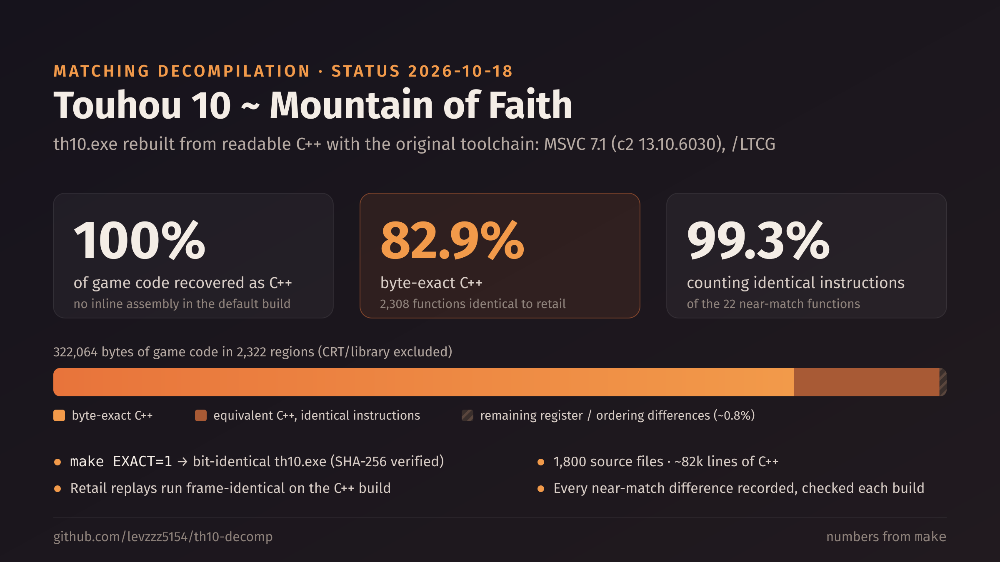

# th10 decompilation handoff — 2026-10-17

## Where the project stands

- `make` is green and `make EXACT=1` produces the bit-identical executable
  (SHA-256 `2f14760b6fbbf575…`). The default build is `4f5f4b69b9e28067…`; it
  changes whenever a shipped equivalent model changes.
- **100.0% of game code recovered** (322,064 of 322,064 bytes, 2,322 of 2,322
  regions); no inline assembly in the default build.
- **76.7% byte-exact C++** (2,289 regions), **97.7%** counting the identical
  instructions of the 33 equivalent regions.
- `callsite_abi.py`, the 129 unit tests and `git diff --check` pass.

## Equivalent recoveries (33)

Instruction counts from the 2026-10-16 build; each layout's `note` points at
its recovery note in `matching2/reference/recovery_notes/`.

| Address | Layout | Bytes | Identical | Recorded diffs | Base/index |
| --- | --- | ---: | ---: | ---: | ---: |
| 0x004067D0 | `projectile_spawn_cell` | 1,472 | 327/354 | 17 | 0 |
| 0x00406D90 | `projectile_command_runtime` | 1,604 | 323/337 | 17 | 0 |
| 0x004084A0 | `projectile_point_count` | 370 | 120/126 | 5 | 0 |
| 0x0040BD80 | `recovery_script_executor` | 1,568 | 400/444 | 28 | 0 |
| 0x0040E770 | `enemy_execute` | 14,416 | 3,174/3,926 | 143 | 0 |
| 0x00414900 | `front_hud_update` | 3,836 | 1,064/1,089 | 22 | 0 |
| 0x00415E90 | `front_script_tick` | 4,480 | 1,144/1,147 | 3 | 0 |
| 0x00417C80 | `manager_teardown` | 1,105 | 291/309 | 15 | 0 |
| 0x0041A200 | `hint_save` | 2,247 | 693/741 | 16 | 0 |
| 0x0041AFD0 | `item_update` | 2,320 | 494/601 | 64 | 0 |
| 0x0041DD80 | `laser_circle_trim` | 1,238 | 260/345 | 57 | 0 |
| 0x0041EB00 | `laser_rectangle_split` | 1,171 | 313/316 | 2 | 0 |
| 0x0041EFA0 | `laser_circle_split` | 1,108 | 241/302 | 47 | 0 |
| 0x00422660 | `result_rows` | 1,062 | 286/288 | 3 | 0 |
| 0x004236F0 | `replay_submenu` | 3,260 | 753/908 | 78 | 1 |
| 0x004247F0 | `player_reset_block_initialize` | 1,435 | 285/314 | 24 | 0 |
| 0x00428F60 | `replay_runtime_bootstrap` | 1,344 | 387/389 | 3 | 0 |
| 0x00429B60 | `replay_save` | 1,681 | 408/535 | 78 | 0 |
| 0x0042A3E0 | `replay_frame_step` | 68 | 22/22 | 0 | 0 |
| 0x0042CDF0 | `title_dispatcher` | 1,128 | 279/291 | 9 | 0 |
| 0x00432CB0 | `name_entry_update` | 1,400 | 368/378 | 10 | 0 |
| 0x00433570 | `replay_save_update` | 1,460 | 397/399 | 0 | 2 |
| 0x00433EF0 | `ui_final_runtime` | 2,796 | 694/741 | 31 | 0 |
| 0x00436DA0 | `font_atlas_fill_transparent` | 946 | 284/316 | 16 | 0 |
| 0x00437FE0 | `font_atlas_draw_text` | 509 | 117/166 | 44 | 0 |
| 0x0043C550 | `camera_shake` | 439 | 133/134 | 2 | 0 |
| 0x0043E8B0 | `animation_change_script` | 287 | 51/66 | 9 | 0 |
| 0x0043EE30 | `anm_vm_tick` | 9,964 | 2,709/2,755 | 23 | 0 |
| 0x004465B0 | `anm_texture_fill_transparent` | 1,463 | 365/499 | 80 | 0 |
| 0x0044A190 | `joystick_poll` | 833 | 251/282 | 10 | 0 |
| 0x0044DF70 | `ecl_start_child` | 550 | 144/165 | 21 | 0 |
| 0x0044E1A0 | `ecl_core_interpreter` | 7,020 | 1,679/1,790 | 12 | 96 |
| 0x00450220 | `ecl_name_table` | 589 | 181/198 | 13 | 0 |

Promoted since: `game_main` (0x00438AD0) is byte-exact through its LTCG
cluster `layout/ltcg/game_main.json` (2026-10-17); its three `/EHsc` callees
are shaped stand-ins, because an ordinary non-`/GL` context cannot give them
their private stack-receiver conventions (`game_main_00438ad0_exact_2026_10_17.md`).
`familiar_refresh` (0x00426F70) is byte-exact through
`layout/ltcg/familiar_refresh_00426f70.json`: one scaled-row accessor at the
carried offset gives the x-pair loads retail's temporary parity
(`familiar_refresh_00426f70_exact_2026_10_17.md`). `midi_tick` (0x0043AF30) is
byte-exact through `layout/ltcg/midi_tick_0043af30.json`: the track element
pointer written as `&table[index]` keeps retail's named-value order
(`midi_tick_0043af30_exact_2026_10_17.md`). `enemy_data_start` (0x0040DC80) is
byte-exact through `layout/ltcg/enemy_data_start_0040dc80.json`: permuting the
BindName helper's parameters fixes the result register and the argument load
order (`enemy_data_start_0040dc80_exact_2026_10_17.md`).

## How to continue

- **Promote what already matches.** Compare a model's relocated bytes with
  retail, not only the gate's verdict (it accepts branches to identical tail
  copies). The recipe is in
  `options_label_refresh_0042e5a0_exact_2026_10_16.md`.
- **Per region:** read its recovery note (each ends with what is left and
  the levers already tried), measure with
  `equivalence.py --layout build_support/layout/equivalent/<name>.json`, and
  compare retail and model listings side by side.
- **Fix context before the body.** Earlier "impossible" allocator residuals
  were closed by changing the cluster context (real callee bodies,
  escaped-global structs, callee parameter order/convention, opaque callees
  where retail reloads `this`), not the function body.
- **Check the semantics and sibling decomps first.** The laser interpreter
  0x0041CA80 went byte-exact once its model was made semantically right; the
  joystick reader went 156 → 16 differences in the th06 decomp's shape.
- **After changing any shipped model:** re-record its differences with
  reviewed classes (never dedupe the lists), run `make`, `make EXACT=1`,
  `make abi-check`, the unit tests, and, for gameplay code, a
  `matching2/tests/replay_sync/` replay.
- **Runtime work** happens in `matching2/build/behavior/` (copied game files,
  separate Wine prefixes `wineprefix`/`wineprefix2`, Xvfb :91/:92). Never kill
  the default Wine server: the MSVC toolchain uses it.
- The c2 tracers live in `matching2/reference/compiler_traces/` (usage line at
  the top of each); they replay a recorded compile/link command from the
  model's work directory.

## What was learned about the compiler (the reusable assets)

1. **The c2 priority law is decoded and validated** (joystick note,
   addenda 3–6): priority = Σ covered-block W×A×L − Σ uncovered-block
   A×L; W = 4 ordinary / 2 addressing-base / loop-depth+1 loop tuples.
   Live tracers: `matching2/reference/compiler_traces/regalloc/trace_accum.py`, `trace_refs.py`;
   landmarks: ChoosePhysReg 0x107AAB62, driver 0x107A926D, picker
   0x107A9D71, per-reference value 0x107A99D9.
2. **Parameter-lowering rule**: an incoming register parameter that is
   live across a call AND written after it gets a memory home — the
   0x0044A190 spill is unavoidable at source level.
3. **/INCLUDE roots freeze declared ABIs**; interprocedural register
   reassignment only reaches call-graph-reached receivers (frame_timer
   bisection).
4. ** volatile parameter splitting** defeats CSE and reproduces retail's
   disjoint live ranges (projectile Spawn prologue breakthrough).
5. **Volatile on storage forces retail's x87 operand order** (frame_timer
   precedent, reused by familiar refresh).
6. Scope-size ladder (does a bigger /GL scope reproduce retail's
   choices?): **final verdict delivered** — no movement at 0/9 extras;
   the 100+/150 rungs are unmeasurable under this wine (cl's
   /showIncludes emission truncates nondeterministically as TU count
   grows, even with file redirection). Combined with the decoded-formula
   proof (priority is a fixed function of the reference structure,
   identical between draft and retail), retail's flip must come from a
   c2-internal component outside the decoded accumulation — the two
   remaining RE targets are the block-weight assignment and the
   initial-home pass. The batched-ladder harness lived in
   `scratch/eclstart/` and was deleted with the scratch trees on 2026-10-14;
   it has to be rebuilt for a future wine upgrade.

## History

- 2026-10-17: 0x00438AD0 GameMain promoted to exact (its LTCG cluster keeps
  fourteen real callee bodies as anchors and shapes stand-ins for the three
  `/EHsc` ones); 0x00426F70 familiar refresh made byte-exact (a scaled-row
  accessor at the carried offset) and promoted; 0x0043AF30 midi tick made
  byte-exact (the `&table[index]` element pointer) and promoted; 0x0040DC80
  enemy data start made byte-exact (BindName parameter order) and promoted;
  byte-exact rises to 76.7%.
- 2026-10-16: 0x0042E5A0 options label refresh made byte-exact; font atlas
  blend 0x00437750 and D3D initialize 0x00439890 promoted; 0x00415E90 result
  dispatcher raised to 1,144/1,147.
- 2026-10-16: readability plan completed (globals, identifiers and files named
  by owner); see `matching2/reference/readability_plan_2026_10_16.md`.
- 2026-10-14: last inline-assembly regions replaced by equivalent recoveries;
  runtime validation and `make abi-check` added
  (`equivalent_runtime_failures_2026_10_14.md`).
