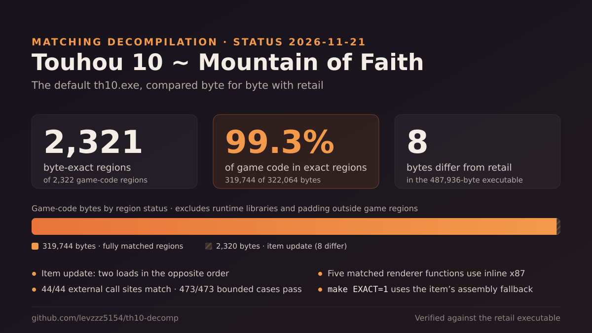

# Touhou 10 matching decompilation

C++ recovery of Touhou 10, checked against the retail `th10.exe` using the
original MSVC 7.1 whole-program optimizer and byte comparisons.



**All 2,322 of 2,322 game-code regions match retail byte for byte.** Together they
cover all 322,064 of 322,064 game bytes (100%), including the 2,320-byte
[item update at `0x0041AFD0`](matching2/msvc/src/game/item/item_update.cpp) and the
1,400-byte [high-score keyboard](matching2/reference/recovery_notes/name_entry_update_00432cb0_exact.md).

The default 487,936-byte executable reproduces the retail `th10.exe` hash
(`2f14760b6fbbf57549541583283badb9a19a4222b90f0a146d5aa17f01dc9040`) with **0 differing bytes**,
no assembly-only fallbacks, and **zero stitched retail `.bin` blobs** committed in Git
(the DOS/Rich headers, `.data`, `.rdata`, and `.rsrc` sections are reconstructed from C++
sources, MSVC 7.1 toolkit libraries, and declarative manifests; the 32×32 icon bitmap is
supplied locally via `matching2/build/assets/th10_icon.ico` or `--verify /path/to/th10.exe`).
Five byte-matched renderer functions still use inline x87 assembly, so `make verify-cpp`
continues to reject this checkpoint as not assembly-free.

## Building

```sh
make                 # Incremental build of the bit-identical th10.exe
make EXACT=1         # Same, forcing assembly fallbacks if any equivalent region is active
make rebuild         # Recompile every unit from scratch
make verify-cpp      # Require the retail file hash and no explicit assembly in maintained sources
make progress        # Region and byte counts per kind, without building
make abi-check       # Check equivalent models pass retail callees the expected register arguments
make behavior-check  # abi-check plus the Unicorn differential tests (see below)
make ltcg-proof      # After make, or with LTCG_ARGS='--oracle /path/to/retail.exe'
```

The output is `matching2/build/msvc/th10.exe`. The build reports both the size
of complete byte-matched regions and the number of individual game bytes that
match at their retail offsets. The latter compares the actual relocated bytes,
including embedded jump tables and any padding within a region; it does not
estimate a byte percentage from instruction counts. Runtime libraries and
padding outside game regions are excluded from both counts.

Requires Python 3.10+, Wine, MSVC 13.10.6030 with LINK 7.10.6030, GNU x86 PE
binutils (`i686-w64-mingw32-ld`), and the pinned GCC, Clang and LLVM-MC
binaries of the optional compiler profiles. The default MSVC toolkit directory
is `~/.local/share/th10-toolchains/msvc-13.10.6030/` (with `bin/`, `include/`
and `lib/`); override it with `make MSVC_ARGS='--toolkit /path/to/toolkit'`.
Run `./matching2/build_msvc.sh --help` for build options.

The normal build uses maintained sources and data only; it does not read a
retail EXE or the disassembly references. Every build, incremental or not,
checks the exact link and every selected C++ replacement (`make verify` is an
alias). `make MSVC_ARGS='--verify /path/to/th10.exe'` also compares the entire
packaged executable with retail. It fails if the number of differing file bytes
does not equal the sum verified in the selected C++ bodies; an exact build must
have zero differences. `make verify-cpp` additionally rejects any assembly region or
explicit assembly in the maintained `matching2/msvc/` sources and headers,
including build support. It cannot be combined with `EXACT=1`. Toolkit
libraries and historical references outside that project are not audited.

The build is incremental. Each compiled unit is kept in a content-addressed
cache under `matching2/build/msvc/cache/`, keyed by the build tools, the
toolkit binaries, the compiler flags, the unit's manifest entries and cluster
layout, and the contents of its sources and every project header they include.
The link and the whole-image comparison always run, so an incremental build
proves exactly what a full one does; a build with nothing to recompile takes a
few seconds. Editing any script under `matching2/tools/` invalidates the whole
cache. `make rebuild` (or `make MSVC_ARGS=--no-cache`) ignores the cache, and
deleting the cache directory is always safe.

## How the code is placed

`matching2/msvc/build_support/regions.json` partitions `.text` into regions and
names the authoritative source of each address. A second naked body in a
non-owning source does not contribute to the executable; remove such
duplicates rather than treating them as unrecovered.
The [build-support guide](matching2/msvc/build_support/README.md#following-a-build-in-the-tools)
maps that ownership to the compiler, object reader, linker and verifier.

**Single units.** `matching2/tools/matching/probe.py` gives the build's byte
gate for one translation unit, which is how a function is recovered and
checked before running `make`:

```sh
python3 matching2/tools/matching/probe.py --source src/core/sprtanim/anm_vm_tick.cpp
```

It compiles the unit through the build's own compile path, requires every
region the unit owns to equal the retail bytes, and checks that each
linker-filled field resolves to the address retail points it at. A converted
function replaces its `__declspec(naked)` body and changes the region's
`symbol` to the name its compiler emits; `--proposal` applies a candidate
region list before the comparison.

**LTCG clusters.** Retail was linked with whole-program optimisation, so many
functions use private register conventions chosen at link time. A cluster
manifest under `build_support/layout/ltcg/` compiles a function together with
its real callers and callees (*anchors*, placed at their retail addresses) in
one native `/LTCG` link, then selects the complete function bytes without
rewriting them. See the
[whole-program LTCG experiment and pipeline](matching2/reference/whole_program_ltcg.md).
`make ltcg-proof` reproduces exact separate-source and combined-source builds,
five controls that retain the public ABI and a fresh-build repeat, with
commands, toolchain hashes, native PE/MAP files, disassembly and byte
comparisons.

**Other compilers.** `source_compilers` in `regions.json` selects per-source
GCC/LLVM-COFF or Clang/LLVM-COFF profiles where MSVC cannot express a recovered
register ABI. Each profile pins its compiler and assembler; the build
assembles the compiler's output unchanged and applies the same byte gate.
The eight 30-byte polar-vector setters share [one x87 C++ implementation](matching2/msvc/include/th10/math/scaled_polar.hpp).
Each keeps its own native entry point, including the variant with independent X and Y scales.

**Runtime library.** The statically linked C/C++ runtime is not transcribed.
A `library` region names a whole section of a member of the toolkit's own
`libcmt.lib`, `libcpmt.lib`, `libc.lib` or `libcp.lib` (translation unit
`lib/<library>/<member>`), linked at its retail address as the original linker
did. `matching2/tools/waves/adopt_crt_library.py` finds such sections; see the
[runtime library note](matching2/reference/recovery_notes/runtime_library_sections_2026-09-28.md).

## Equivalent recoveries

All 2,322 game-code regions are currently byte-exact (`equivalent_recoveries` in
`regions.json` is empty). The build and verification pipeline still supports
equivalent C++ recoveries when developing or bisecting a region: an equivalent
layout under `build_support/layout/equivalent/` is checked instruction by
instruction against retail by [`equivalence.py`](matching2/tools/matching/equivalence.py)
and audited for call-site register conventions by `make abi-check`. Once a model
matches retail byte for byte, it is promoted to a native LTCG cluster and its
equivalent layout and assembly fallback are removed (see
[the 0x0042E5A0 promotion](matching2/reference/recovery_notes/options_label_refresh_0042e5a0_exact_2026_10_16.md)).

## Validating the build

Beyond whole-image byte verification, three behavioral checks guard against
regressions during refactoring:

* `make abi-check` (`matching2/tools/matching/callsite_abi.py`, needs
  `capstone`) pairs any active equivalent model's calls into retail code with
  retail's and compares where every register argument comes from.
* `make behavior-check` also runs Unicorn differential tests for the item
  update (473 cases), high-score keyboard (307 cases across all 91 grid cells),
  and replay submenu (48 cases):

  ```sh
  python3 -m venv matching2/build/behavior-venv
  matching2/build/behavior-venv/bin/pip install unicorn==2.1.4
  make behavior-check   # picks up the venv automatically
  ```

* `matching2/tests/replay_sync/` plays a replay in retail and in the build under
  the same Wine install and compares score, lives, power, stage, the gameplay
  RNG and the player block every frame. On 2026-10-14 three full replays were
  identical to retail for every frame: Normal all clear (86,200 frames), Easy
  all clear (48,428, where retail and the build both fault at the same frame)
  and Extra clear (43,353). Under this Wine setup retail itself drifts from the
  recordings late in those runs, so the build is compared with retail's trace.

For a standalone differential test under `matching2/tests/`, start with
[`x86_fixture.py`](matching2/tests/x86_fixture.py): it verifies the retail
`.text` hash, defines the emulated addresses and preserved registers, and loads a
single candidate function. Use `maintained_region(retail_address)` for a
maintained function's source and symbol; both can change when a recovery is
renamed. [`coff_module.py`](matching2/tests/coff_module.py) loads complete
test modules when their data, helpers or unwind tables must move with the code.

## Repository layout

- `matching2/msvc/src/` and `include/`: maintained implementations, data tables
  (`src/data/`), and types, organised by ZUN's retail files; see
  [the source map](matching2/msvc/src/README.md).
- `matching2/msvc/build_support/`: placement manifests (`regions.json`,
  `pe_layout.json`, `data_layout.json`, `rdata_layout.json`, `rsrc_layout.json`),
  native LTCG cluster specs, private compiler units, ABI contexts, import thunks
  and embedded data; see [the build-support guide](matching2/msvc/build_support/README.md).
- `matching2/reference/recovery_notes/`: one note per recovered or parked
  region, with what moved it and what is left.
- `matching2/reference/compiler_traces/`: gdb tracers for c2.dll internals
  (register allocation, scheduling, flow graph, stack packing, operand order).
- `matching2/reference/legacy_semantic/`: archived runtime-oriented C++ models
  for reverse-engineering reference; not build inputs.
- `matching2/tools/`: compiler, linker, byte verification and progress tools; see
  [the tools guide](matching2/tools/README.md).
- `ida/`: original IDA disassembly and decompiler output.
- `decompiled/ghidra_augmented/`: supplementary disassembly, pseudocode and
  address index (`index.tsv`); `ghidra_alternates/` preserves four alternate
  function boundaries.
- `docs/status.svg`: source of the status image (`rsvg-convert -z 2` renders
  `status.png`).
